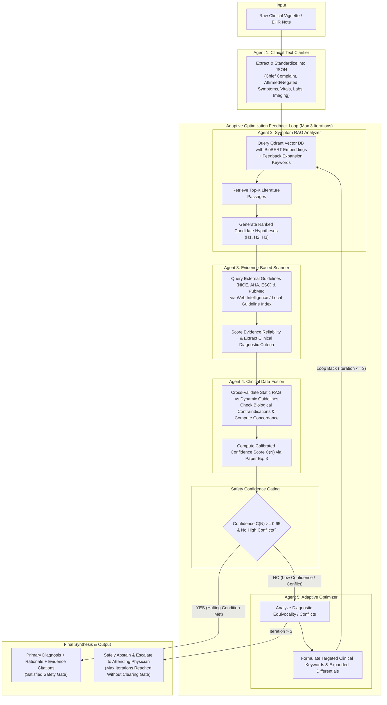
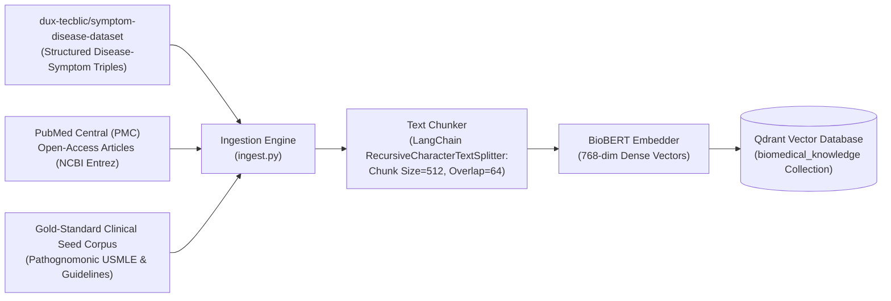

# Technical Architecture & Implementation Guide: Adaptive Multi-Agent CDSS

This document provides a comprehensive technical reference for our implementation of the **Adaptive Multi-Agent Clinical Decision Support System (CDSS)** based on the foundational paper:

> **Öğdü, E. et al. (IEEE Access, 2025)**  
> *"An Adaptive Multi-Agent LLM-Based Clinical Decision Support System Integrating Biomedical RAG and Web Intelligence"*

---

## 1. High-Level System Architecture & Flow

The system operates as a **closed-loop multi-agent reasoning framework**. Unlike standard single-pass LLM prompts or simple RAG wrappers, our system decouples clinical decision-making into **5 specialized autonomous agents**, incorporates **hybrid static/dynamic evidence retrieval**, and enforces an **adaptive feedback loop** governed by mathematical confidence gating.



---

## 2. The 5 Specialized Clinical Agents

Each agent has a single, strictly delineated responsibility with dedicated prompts, inputs, schemas, and error boundaries.

### Agent 1: Clinical Text Clarifier
* **Source File**: [`backend/src/cdss/agents/clarifier.py`](file:///Users/praneethnukala/Documents/Major/backend/src/cdss/agents/clarifier.py)
* **Pydantic Schema**: [`ClinicalNote`](file:///Users/praneethnukala/Documents/Major/backend/src/cdss/schemas.py)
* **Purpose**: Raw clinical notes (EHR narratives, USMLE vignettes, triage logs) are notoriously noisy, unstructured, and filled with medical abbreviations and negated symptoms. Agent 1 standardizes this text into a normalized clinical data structure.
* **Key Capabilities**:
  1. **Negation Disambiguation**: Differentiates between affirmed symptoms and explicitly denied symptoms (e.g., *"denies chest pain or shortness of breath"* is flagged with `is_negated: true`, preventing false-positive RAG queries).
  2. **Biomarker & Vital Sign Structuring**: Normalizes blood pressures, heart rates, oxygen saturations, and critical lab values (troponins, D-dimer, BNP, glucose, arterial blood gas pH) into structured objects with `high`/`low`/`normal` flags.
  3. **Diagnostic Modality Extraction**: Segregates ECG telemetry findings and imaging observations (CT angiography intimal flaps, chest X-ray consolidations).
* **Dual Execution**: Uses LLMs (`OpenRouter`, `Groq`, or `Gemini`) with automatic fallback to an offline regex/rule parser ([`parse_clinical_text_offline`](file:///Users/praneethnukala/Documents/Major/backend/src/cdss/llm/registry.py#L18-L120)).

---

### Agent 2: Symptom RAG Analyzer
* **Source File**: [`backend/src/cdss/agents/rag_analyzer.py`](file:///Users/praneethnukala/Documents/Major/backend/src/cdss/agents/rag_analyzer.py)
* **Pydantic Schema**: [`DiagnosticHypothesis`](file:///Users/praneethnukala/Documents/Major/backend/src/cdss/schemas.py), [`RetrievedPassage`](file:///Users/praneethnukala/Documents/Major/backend/src/cdss/schemas.py)
* **Purpose**: Generates candidate disease hypotheses grounded strictly in dense vector retrieval from biomedical literature, eliminating hallucinations.
* **How It Operates**:
  1. Combines affirmed symptoms, abnormal laboratory biomarkers, vital signs, and active **feedback keywords** from Agent 5 into a clinical retrieval query.
  2. Executes vector search against the local **Qdrant** database using **BioBERT** 768-dimensional embeddings.
  3. Evaluates retrieved passages against the patient note to produce a ranked list of candidate diagnoses ($H_1, H_2, H_3$) with relevance scores ($s_{\text{rag}} \in [0.0, 1.0]$) and exact supporting text snippets.

---

### Agent 3: Evidence-Based Scanner
* **Source File**: [`backend/src/cdss/agents/evidence_scanner.py`](file:///Users/praneethnukala/Documents/Major/backend/src/cdss/agents/evidence_scanner.py)
* **Pydantic Schema**: [`WebEvidence`](file:///Users/praneethnukala/Documents/Major/backend/src/cdss/schemas.py)
* **Purpose**: Performs dynamic external validation by querying current clinical practice guidelines (NICE, ACC/AHA, ESC) and recent PubMed articles for each proposed hypothesis.
* **How It Operates**:
  1. For each candidate from Agent 2, generates targeted queries (e.g., `"{condition_name} diagnostic criteria guidelines NICE PubMed"`).
  2. Queries live web intelligence via **Serper API** or retrieves Level-A clinical practice guidelines from the indexed guideline corpus.
  3. Extracts validated diagnostic criteria, assigns an evidence reliability score ($s_{\text{web}} \in [0.0, 1.0]$), and captures official source URLs, PMIDs, or DOIs.

---

### Agent 4: Clinical Data Fusion
* **Source File**: [`backend/src/cdss/agents/fusion.py`](file:///Users/praneethnukala/Documents/Major/backend/src/cdss/agents/fusion.py)
* **Pydantic Schema**: [`ClinicalFusionReport`](file:///Users/praneethnukala/Documents/Major/backend/src/cdss/schemas.py), [`ConflictItem`](file:///Users/praneethnukala/Documents/Major/backend/src/cdss/schemas.py)
* **Purpose**: Synthesizes the dual evidence streams (static RAG literature vs. dynamic clinical guidelines), detects contradictory indications or biological contraindications, and computes the mathematical confidence score governing the safety gate.
* **Mathematical Confidence Calibration (Paper Equation 3)**:

  $$\text{Raw Score } C_{\text{raw}} = w_r \cdot s_{\text{rag}} + w_e \cdot s_{\text{web}} + w_c \cdot c - w_k \cdot p$$

  Where:
  * $w_r = 0.35$: Static RAG biomedical literature weight
  * $w_e = 0.25$: Dynamic guideline evidence weight
  * $w_c = 0.40$: Semantic cross-validation concordance weight
  * $w_k = 0.30$: Conflict penalty weight
  * $c \in [0.25, 1.0]$: Concordance score measured via BioBERT vector cosine similarity and token alignment across evidence streams.
  * $p \in [0.0, 1.0]$: Conflict penalty levied for biological contradictions (e.g., normal troponin in suspected STEMI, negative head CT in suspected intracranial bleed, or diagnostic equivocality between competing conditions).

  $$\text{Calibrated Confidence } C(N) = \sigma(3.0 \cdot (C_{\text{raw}} - 0.50)) = \frac{1}{1 + e^{-3.0 \cdot (C_{\text{raw}} - 0.50)}}$$

* **Safety Gate Condition**:
  $$\text{Halting Condition} \iff C(N) \ge \tau \ (0.65) \quad \text{AND} \quad \text{High-Severity Conflicts} = 0$$

---

### Agent 5: Adaptive Optimizer
* **Source File**: [`backend/src/cdss/agents/optimizer.py`](file:///Users/praneethnukala/Documents/Major/backend/src/cdss/agents/optimizer.py)
* **Pydantic Schema**: [`FeedbackReport`](file:///Users/praneethnukala/Documents/Major/backend/src/cdss/schemas.py)
* **Purpose**: Governs the closed-loop multi-round feedback cycle. If Agent 4's calibrated confidence is below $\tau = 0.65$ or a critical conflict is flagged, Agent 5 activates.
* **How It Operates**:
  1. Identifies the root cause of diagnostic equivocality (e.g., missing confirmatory serology, overlapping presentation between PE and heart failure).
  2. Formulates expanded diagnostic search terms (imaging modalities, serological markers, differential pathways).
  3. Injects these `recommended_keywords` back into Agent 2 for Iteration 2 (or Iteration 3).
  4. **Abstention & Escalation Protocol**: If 3 iterations expire without clearing $\tau = 0.65$, Agent 5 safely abstains from issuing an automated conclusion and outputs an explicit clinical escalation report for attending physician review.

---

## 3. How the Corpus is Created

The biomedical corpus provides the foundational medical facts used for dense vector retrieval. It is generated through an automated multi-source ingestion pipeline:



1. **Symptom-Disease Dataset** ([`symptom_disease.py`](file:///Users/praneethnukala/Documents/Major/backend/src/cdss/corpus/symptom_disease.py)):
   * Pulls canonical medical associations linking diseases, clinical manifestations, risk factors, and ICD-10 diagnostic codes.
2. **PubMed Central (PMC) Diagnostic Literature** ([`pubmed.py`](file:///Users/praneethnukala/Documents/Major/backend/src/cdss/corpus/pubmed.py)):
   * Uses the NCBI Entrez E-utilities API (`esearch` + `efetch`) to fetch full-text diagnostic review papers, prospective clinical trials, and meta-analyses.
3. **Gold-Standard Clinical Seed Corpus** ([`gold_corpus.py`](file:///Users/praneethnukala/Documents/Major/backend/src/cdss/corpus/gold_corpus.py) & [`seed_gold.py`](file:///Users/praneethnukala/Documents/Major/backend/src/cdss/corpus/seed_gold.py)):
   * Contains verified reference passages for clinical presentation patterns across cardiology, pulmonology, endocrinology, nephrology, neurology, and gastroenterology.
4. **Chunking Pipeline** ([`ingest.py`](file:///Users/praneethnukala/Documents/Major/backend/src/cdss/corpus/ingest.py)):
   * Implements LangChain's `RecursiveCharacterTextSplitter` with chunk size of 512 characters and 64-character overlap to preserve semantic context across sentence boundaries.

---

## 4. How the RAG Pipeline is Created

Our Retrieval-Augmented Generation (RAG) system uses dense semantic vector search rather than brittle keyword matching:

### Dense Biomedical Embeddings
* **Model**: `pritamdeka/BioBERT-mnli-snli-scinli-scitail-mednli-stsb`
* **Embedding Class**: [`BioBERTEmbedder`](file:///Users/praneethnukala/Documents/Major/backend/src/cdss/retrieval/embedder.py#L18-L76)
* **Dimensionality**: 768 dimensions.
* **Hardware Acceleration**: Automatically uses Apple Silicon GPU (`mps`), NVIDIA CUDA (`cuda`), or CPU with offline caching.

### Vector Database Architecture
* **Engine**: **Qdrant** embedded on-disk engine ([`index.py`](file:///Users/praneethnukala/Documents/Major/backend/src/cdss/retrieval/index.py)).
* **Collection Name**: `biomedical_knowledge`.
* **Distance Metric**: **Cosine Similarity**:

  $$\text{Cosine Similarity}(\vec{u}, \vec{v}) = \frac{\vec{u} \cdot \vec{v}}{\|\vec{u}\| \|\vec{v}\|}$$

* **Payload Storage**: Each indexed point stores the text chunk, parent document title, ICD-10 code, disease category, and source reference.

### Search & Re-Ranking
* **Retriever Class**: [`ClinicalRetriever`](file:///Users/praneethnukala/Documents/Major/backend/src/cdss/retrieval/search.py#L21-L100)
* Performs top-$k$ nearest-neighbor retrieval ($k=5$ to $10$).
* Merges feedback expansion keywords from the Adaptive Optimizer into the query vector to shift the search space dynamically across iterations.

---

## 5. Model Roles & Usage

The architecture uses specialized models for different stages of the pipeline:

| Model / Component | Primary Role | Why This Model is Used |
| :--- | :--- | :--- |
| **BioBERT Embedder** (`pritamdeka/BioBERT...`) | Dense vector generation for clinical chunks and RAG queries | Pre-trained on PubMed and MedNLI; understands medical terminology that standard text embedders miss. |
| **Groq / DeepSeek-R1-Distill-Llama-70B** | Primary clinical reasoning engine for Agents 1, 2, 4, and 5 | Fast inference, strong Chain-of-Thought (CoT) diagnostic synthesis, and pathognomonic sign recognition. |
| **Google Gemini 2.0 / 2.5 Flash** | Multi-modal reasoning and high-throughput diagnostic analysis | High token-per-minute limits, native JSON-schema structured output enforcement. |
| **OpenRouter (Unified Gateway)** | Frontier multi-model access (Claude 3.5 Sonnet, GPT-4o, DeepSeek) | Provider failover protection; handles API rate limits by routing requests dynamically. |
| **Serper API** | Real-time web intelligence for Agent 3 (Evidence Scanner) | Google Search index access to locate Level-A clinical practice guidelines (NICE, AHA, ESC) and PubMed IDs. |
| **Offline Heuristic Parser** | Zero-cost deterministic local fallback | Allows the complete application to run locally on Apple Silicon MPS without active API keys. |

---

## 6. Datasets & Live Benchmark Verification

The base paper (*Öğdü et al.* §IV) evaluates the CDSS across three benchmark datasets, all of which are integrated into our live benchmark runner:

1. **🩺 MedQA (USMLE Step 1 & 2 Examination)**:
   * **Dataset Pool**: 1,273 USMLE multi-choice clinical vignettes.
   * **Task**: Given a patient clinical presentation, select the correct primary diagnosis or management step.
2. **🔬 PubMedQA (Biomedical Research Evaluation)**:
   * **Dataset Pool**: 1,000 labeled biomedical research study abstracts.
   * **Task**: Analyze research methodology and abstract findings to reach a definitive conclusion (`Yes`, `No`, or `Maybe`).
3. **💊 MedBullets (Applied Clinical Residency Scenarios)**:
   * **Dataset Pool**: 50 clinical residency scenarios.
   * **Task**: Applied pharmacotherapy, emergency interventions, and pathognomonic diagnostic recognition.

### Dynamic Randomized Verification
* Every execution dynamically samples a **random 10 test cases** without replacement via [`get_random_dataset_cases()`](file:///Users/praneethnukala/Documents/Major/backend/src/cdss/eval/datasets.py#L425-L460).
* Results stream live into the frontend **Live Execution Log Console** with timestamps, confidence scores, iteration counts, and PASS/FAIL verdicts.

---

## 7. Codebase Directory Reference

```text
Major/
├── backend/
│   ├── src/cdss/
│   │   ├── orchestration/
│   │   │   └── pipeline.py          # 5-Agent Closed-Loop Pipeline Orchestrator
│   │   ├── agents/
│   │   │   ├── clarifier.py         # Agent 1: Clinical Text Normalizer
│   │   │   ├── rag_analyzer.py      # Agent 2: Symptom RAG Vector Analyzer
│   │   │   ├── evidence_scanner.py  # Agent 3: Live Guideline & Web Scanner
│   │   │   ├── fusion.py            # Agent 4: Multi-Source Fusion & Eq. 3 Confidence
│   │   │   └── optimizer.py         # Agent 5: Adaptive Optimizer & Feedback Loop
│   │   ├── retrieval/
│   │   │   ├── embedder.py          # BioBERT Dense Embedding Wrapper
│   │   │   ├── index.py             # Qdrant Vector Collection Indexer
│   │   │   └── search.py            # Nearest-Neighbor Hybrid Search
│   │   ├── corpus/
│   │   │   ├── symptom_disease.py   # Symptom-Disease Dataset Ingestion
│   │   │   ├── pubmed.py            # NCBI Entrez PubMed Literature Fetcher
│   │   │   ├── gold_corpus.py       # Clinical Seed Knowledge Base
│   │   │   └── ingest.py            # Chunking and Ingestion CLI Script
│   │   ├── llm/
│   │   │   ├── registry.py          # LLM Provider Dispatcher & Offline Parser
│   │   │   └── providers/           # OpenRouter, Groq, and Gemini HTTP Adapters
│   │   ├── eval/
│   │   │   └── datasets.py          # MedQA, PubMedQA, and MedBullets Loaders
│   │   └── api/
│   │       └── server.py            # FastAPI REST & Benchmark Streaming Server
└── frontend/
    └── src/app/
        ├── app.ts                   # Angular Signals State & Benchmark Controller
        └── app.html                 # Diagnostic Playground & Live Benchmark UI
```
